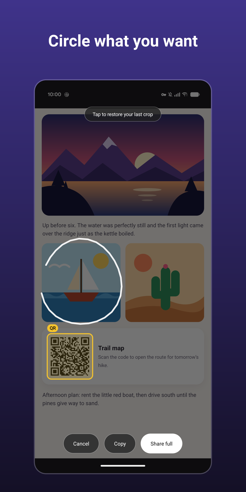
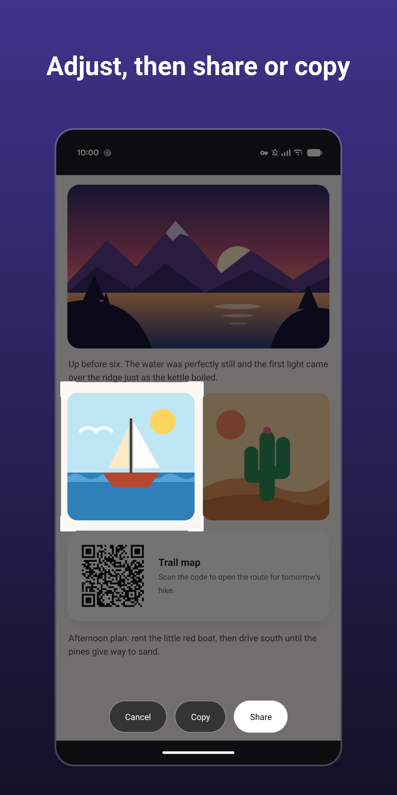
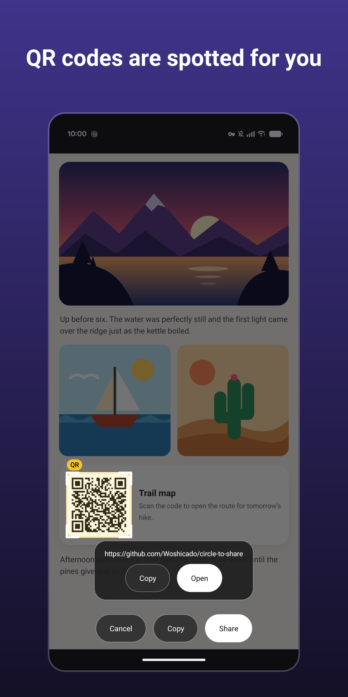
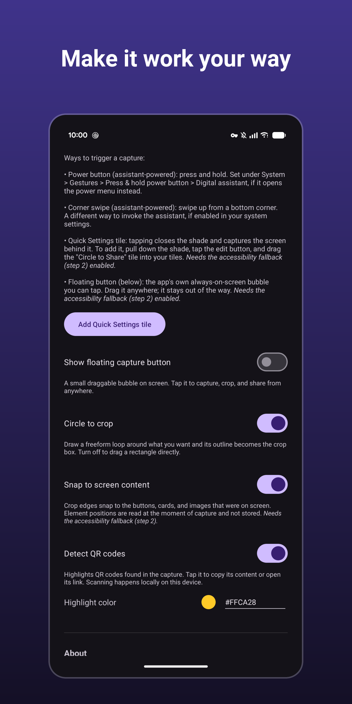

# Circle to Share

> [!WARNING]
> **Built with AI/LLM assistance.**
>
> This app was written with assistance from Claude (Fable and Opus).
> Expect the kinds of mistakes LLMs typically make.
> Review the code before relying on it, and please report anything that looks off.

Grab the screen from anywhere, crop it, share it — without saving anything to your device.

<p>
  
  
  
  
</p>

Trigger it → the screen freezes → circle what you want → **Share** or **Copy**. The crop lives only in the app's private cache (auto-cleaned after an hour); nothing ever hits your gallery.

The loop's outline becomes a crop box you can resize and reposition. Prefer dragging a rectangle directly? Turn off **Circle to crop** in the app.

## Triggering it

Use any of these:

- **Power button (press & hold)** — works via the digital-assistant role.
- **Swipe up from a bottom corner** — another way to invoke the digital assistant, if enabled in your system settings.
- **Quick Settings tile** — add it with the **Add Quick Settings tile** button in the app (Android 13+), or by hand: pull down the shade → edit (pencil) → drag the *Circle to Share* tile in. Tapping it collapses the shade and captures what was behind it. Needs the accessibility fallback — without it the tile explains itself and opens the app.
- **Floating bubble** — an optional, always-on-screen draggable button (toggle in the app). Tap it to capture from any app; long-press to open the app.
- _Or any other way that starts your digital assistant_

## How it works

- The app registers as a **digital assistant** (`VoiceInteractionService`). Whatever launches the assistant — a press-and-hold of the power button, or a swipe up from a bottom corner — now opens the crop overlay instead of the previous assistant.
- The system hands assistants a screenshot of the current screen (`onHandleScreenshot`). On devices/ROMs that don't provide it to third-party assistants, an **accessibility service** (`AccessibilityService.takeScreenshot`) captures instead.
- The **Quick Settings tile** (`TileService`) is a third entry point that needs neither the assistant role nor a permanently visible button. It drives the same accessibility capture as the bubble: on tap it dismisses the shade (`GLOBAL_ACTION_DISMISS_NOTIFICATION_SHADE`), waits out the collapse animation, then shoots.
- Shared images go out through a `FileProvider` URI backed by `cacheDir`; requiring no storage permission, no gallery entry, no cleanup chores.
- **Snap to screen content** (optional, off by default): when enabled, crop edges snap to the buttons, cards, and images that were on screen, read from the accessibility node tree. Element *positions* are read once, at the moment of capture, solely to align the crop box — nothing is stored or transmitted. This is why the accessibility service declares the "retrieve window content" capability; leave the toggle off and the bounds are never read at all.

## Build & install

With [mise](https://mise.jdx.dev/) (pins JDK 17 automatically):

```sh
mise run build                    # debug APK
mise run deploy --build           # build debug, then install on a connected device (adb)
mise run deploy --build --release # build the signed release, then install it
mise run deploy                   # install the newest existing APK (debug or release)
```

Or directly with Gradle:

```sh
./gradlew assembleDebug
adb install app/build/outputs/apk/debug/app-debug.apk
```

Or open the project in Android Studio and hit Run.

### Tests

```sh
./gradlew testDebugUnitTest          # JVM: which QR payloads get an "Open" button, and as what
./gradlew connectedDebugAndroidTest  # on a device/emulator: the crop overlay's touch gestures, the setup screen's color field
```

The instrumented run stops the app's process when it finishes, after which Android leaves the accessibility service unbound — switch it off and on again in Settings → Accessibility before using the app on that device. While it runs it also switches **Detect QR codes** off and changes the **Highlight color**, and puts your settings back at the end.

## Permissions

None. The APK declares **zero** permissions — no internet, storage, camera, mic, or location.
Screen capture is granted implicitly by the assistant/accessibility bindings, and sharing goes through a `FileProvider`, so nothing extra is needed.

## Setup on the phone

_Requires Android 11 or newer._

1. Open the app and follow the three steps:
   1. **Set as assistant**: Settings → Apps → Default apps → Digital assistant app → *Circle to Share*. If a "Use screen data" toggle appears there, turn it on.
   2. **Enable the fallback** (recommended): tap **Open accessibility settings**, read the disclosure of what the service accesses and tap **Agree**, then under Accessibility → *Circle to Share* turn on the master **Use** toggle. Only needed if step 1 alone shows "Couldn't get a screenshot", or for the tile, the bubble and snapping.
   3. **Test** with the in-app button, then try the real gesture from any app.

> [!NOTE]
> **"Restricted setting" blocking the accessibility toggle?**
>
> Because the app is sideloaded (installed outside an app store), Android blocks it from enabling accessibility until you explicitly allow it.
> If the toggle is greyed out or you see *"Restricted setting"*, go to **Settings → Apps → Circle to Share → ⋮ (top-right menu) → Allow restricted settings**, then return to Accessibility and enable the **Use** toggle.
>
> Official instructions: <https://support.google.com/android/answer/12623953#allowrestrictedsettings>.

## Notes

- Apps that set `FLAG_SECURE` (banking, DRM video) can't be captured.
- Tapping outside the selection clears it; with no selection, **Share full** sends the entire screen.
- "Copy" puts the image on the clipboard (paste into messengers via Gboard etc.).
- Shortcuts in the overlay: **double-tap inside** the box shares, **long-press inside** copies, **double-tap on empty space** (nothing selected) exits. The top hint becomes tappable when your previous crop fits the new capture — tap it to restore that exact box.
- The accessibility service does nothing until you have agreed to the in-app disclosure — switching it on in Settings alone is not enough. Updating from a version before 0.3.0 with the service already on, the app asks the next time you open it; **No thanks** switches the service off.
- After an update that changes the accessibility service's declared capabilities (e.g. adding snap-to-content), Android may switch the service off — just re-enable it in Settings → Accessibility.

## Support

[](https://ko-fi.com/woshicado)

If this app is useful to you, consider supporting its development: ☕ **[ko-fi.com/woshicado](https://ko-fi.com/woshicado)**

## License

Circle to Share is free software: you can redistribute it and/or modify it
under the terms of the GNU General Public License as published by the Free
Software Foundation, either version 3 of the License, or (at your option)
any later version. See [LICENSE](LICENSE).
